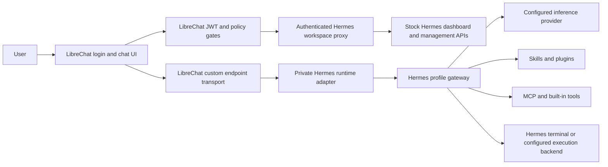

# Integration architecture

## Management

The browser never connects directly to the internal Hermes runtime. The sidebar opens `/hermes`
in LibreChat. A successful LibreChat-authenticated POST to `/hermes-workspace/_session` mints
an opaque, HttpOnly workspace cookie, valid for 90 seconds and renewed every 45 seconds while
the workspace is mounted. Its path is `/hermes-workspace`; it is Secure over HTTPS and SameSite
Lax so top-level MCP OAuth callbacks work. All mutating workspace requests require the exact
configured Origin. The bootstrap itself also requires a LibreChat bearer token and manager access.

For HTTP management requests, the server resolves the opaque cookie to the authenticated
LibreChat bearer, runs LibreChat's existing authentication/enrollment/retirement gates, checks
the management role, then proxies to a fixed Hermes origin. The server signs into Hermes with
the configured password provider and maintains a private cookie jar, including cookie rotation.
Hermes cookies, provider secrets used for transport, and LibreChat JWTs are not handed to the
embedded UI. Explicit credential-management responses remain accessible to authorized operators,
as they are in Hermes's own dashboard.

`X-Forwarded-Prefix` invokes Hermes's existing subpath support for routing and assets.
Original JSON and form bytes are captured before Express parsing. The Hermes workspace bypasses
Mongo-specific key sanitization so dotted provider names and JSON Schema `$` keys survive;
ordinary LibreChat routes retain their existing sanitizer. File byte ranges are forwarded.
`HERMES_DASHBOARD_PUBLIC_URL` points to the public LibreChat origin plus `/hermes-workspace`,
so generated OAuth callbacks do not point at the internal Docker hostname. Root dashboard
login/logout routes are blocked: LibreChat owns the user's sign-in/out flow.

WebSocket upgrades require a current workspace grant, matching Origin and a fresh manager
lookup. The proxy tunnels only to the fixed dashboard origin. It closes sockets when the
grant expires or is revoked; a live renewed grant extends the connection. The bridge forwards
Hermes's existing WebSocket ticket protocol rather than replacing it.

## Execution and identity

The generated LibreChat configuration exposes one custom endpoint, **Hermes**, using a private
bridge key. Server-generated header templates supply the authenticated LibreChat user ID and
conversation ID. The bridge validates its service key and verifies that the user still exists.
Those headers are trusted only on this server-authenticated path; browser bearer tokens cannot
call the runtime adapter directly.

The bridge derives an opaque session namespace from the server key, user ID and conversation ID
and supplies `X-Hermes-Session-Key`. **This is chat-session separation, not a Hermes user account
or per-user authorization boundary.** Hermes sees the session key and the selected shared
profile. Its profile-level memory, credentials, tools and workspace can be shared across users.
The management proxy uses one Hermes service account; Hermes's own management logs identify
that service account rather than a separate Hermes identity for every LibreChat operator.

`Agent: <profile>` resolves against the live Hermes profile roster, checks the profile's model
catalog and calls `/p/<profile>/v1/chat/completions` (the default profile uses `/v1/...`). Named
profile gateway keys are derived separately using HMAC and installed through Hermes's scoped
credential API when an operator enables the profile. Rotating the bridge key requires
re-enabling named profiles. Provider keys remain owned/resolved by Hermes.

`Model: <model route>` runs that registered model through the default Hermes profile. The bridge
allowlists generation fields and refuses body-level provider, profile and credential overrides.
Unknown profiles/models fail closed. SSE response streaming and request cancellation use the
underlying HTTP connection; no second tool runtime runs inside this adapter.

LibreChat v0.8.9 uses a unified `AgentClient` even for custom endpoints. The integration therefore
keeps that client as the UI transport but removes local skill, memory, tool and execution
registration before initialization. Managed mode admits only the configured Hermes endpoint,
rejects native agent IDs, and disables ephemeral native tool toggles. The initializer enforces
the same transport restriction for API/background ingress. The runtime adapter also
rejects non-empty LibreChat tool/function definitions.

## Boundaries

This pilot is for trusted operators with host-level agent capabilities. It is not a tenant
isolation layer. Private user environments would require server-owned user-to-profile/worker
mapping, filtered management APIs, scoped credentials and storage, and isolated code execution.
Workspace grants are stored in one LibreChat process; use one API replica for this pilot.
Horizontal scaling requires a shared grant store and an appropriate WebSocket routing strategy.

The embedded stock UI exposes current dashboard functionality, including installed plugin pages.
CLI-only operations still require Hermes's terminal or CLI. Network ingress for external channel
webhooks, external credentials, optional packages, desktop permissions and hardware must be
configured separately. A visible control does not make an unavailable external service usable.

Existing native LibreChat agent/skill/MCP records are not silently converted. Their managers are
disabled in the generated configuration. Recreate/import the desired resources through the
Hermes workspace. Native LibreChat RAG indexes are not automatically mounted into Hermes;
connect a retrieval service through Hermes MCP/tools when needed. Inference residency depends
on the selected provider and endpoint, not the EC2 location alone.
