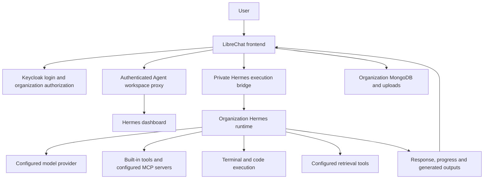
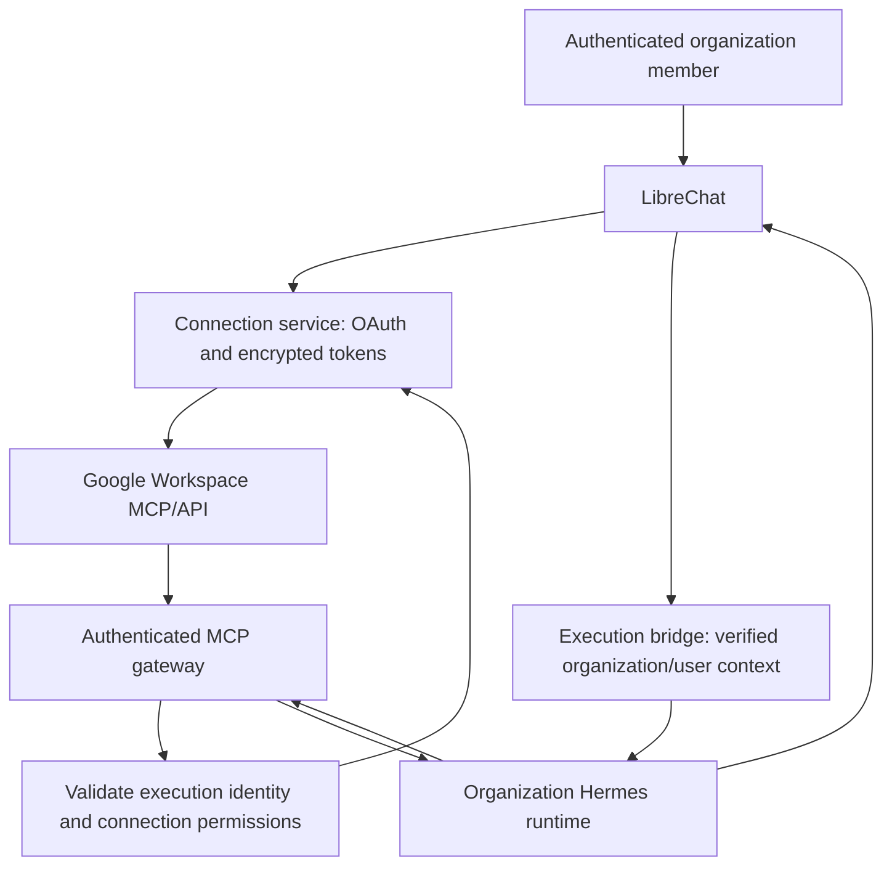

# Open Harness — product, implementation and discussion summary

Prepared: November 25, 2026  
Workspace: `D:\open_harness`  
Repository: https://github.com/naqibfaiyaz/open_harness  
Last application deployment verified in this conversation: `4641b489124ad9ecfd8e715dfd3a6cea2b6024a2`

## 1. What we are building

Open Harness is an organization-based AI chat and agent platform. Users work in a
LibreChat frontend, while Hermes runs the agents, models, skills, tools and code
execution. Organizations have their own application data and Hermes environment.
Keycloak provides identity management, with organization roles and enterprise SSO
configuration exposed through LibreChat.

The aim is to offer a familiar experience comparable to ChatGPT and Claude while
giving organizations control over model providers, tools, integrations and data
residency. The pilot reuses existing open-source software rather than rebuilding
the chat interface, agent runtime or identity system.

The initial business offering discussed includes:

- Chat and agent capabilities together.
- Access to multiple models through selected providers.
- Global inference using OpenRouter or an equivalent provider, with our own pricing.
- A Canada-only offering with controlled inference location.
- Managed services and dedicated deployment by contacting us.
- Self-service organization signup, followed later by billing and usage management.

**Hosting the application in Canada does not by itself make inference, embeddings
or external tool processing Canada-only.** Provider selection and routing must
enforce that requirement separately.

## 2. How to read the status

This document combines the work recorded in this conversation with the repository's
implementation notes. It is not a new audit of every live organization or external
service.

| Status | Meaning |
| --- | --- |
| Built/deployed | Implemented in the pilot and recorded as deployed in this conversation. |
| Built; configuration required | Code exists, but credentials, settings or an external service are still needed. |
| Discussed/planned | Agreed direction or recommendation; not an implemented feature. |
| Historical | Earlier pilot behavior superseded by later integration work. |

The latest date-handling release was verified live. Older feature sections rely on
their corresponding implementation records. Where external credentials or actual
email delivery were not verified, that limitation is stated explicitly.

## 3. Current technology stack

| Layer | Technology and responsibility |
| --- | --- |
| Frontend and chat history | Customized LibreChat, based on the v0.8.9 source tree. |
| Agent execution | Pinned upstream Hermes image; integration files and a reporting-policy plugin are mounted alongside it. |
| Integration backend | TypeScript in LibreChat's `packages/api`; legacy Express files primarily provide wiring. |
| Frontend customizations | React/TypeScript components in the LibreChat client. |
| Shared configuration and contracts | LibreChat `packages/data-provider`. |
| Application persistence | MongoDB and persistent upload/data volumes. |
| Identity | Keycloak with PostgreSQL, organization realms, OIDC and configurable identity brokering. |
| Provisioning/control plane | Python service with a SQLite registry and a protected Unix socket. |
| Ingress and TLS | Caddy with public HTTPS hostnames and private service routing. |
| Packaging | Docker and Docker Compose on EC2. |
| Source and deployment | GitHub Actions, AWS OIDC, ECR and Systems Manager deployment. |
| Inference | Configurable through Hermes; OpenRouter was connected in the pilot. Bedrock was discussed but is not the selected implemented inference path. |
| Retrieval | A private RAG/pgvector setup was tested during an earlier phase; current managed agent execution requires an explicit Hermes-accessible retrieval integration. |

## 4. Current application architecture



The central design is: **LibreChat manages the user experience; Hermes executes the
agent work.** There is no second LibreChat agent/tool loop running alongside Hermes
in the managed transport.

## 5. LibreChat and Agent workspace integration — built/deployed

### Workspace management

Hermes' existing dashboard is embedded in LibreChat through an authenticated proxy.
It is an iframe-based integration with customized navigation and theme extension,
not a complete native React rewrite of Hermes' management screens.

The workspace provides access to Hermes capabilities such as:

- Agents and profiles.
- Models, providers and credentials.
- Skills and tool configuration.
- MCP servers.
- Plugins and memory.
- Schedules, sessions and files.
- Channels, webhooks, usage and system controls.

Visibility of a capability does not mean its external dependencies are configured.
Some features still require provider credentials, extra packages or a supported
runtime.

### Navigation and appearance

- The workspace entry is presented as Agent workspace in the product experience.
- Its navigation uses LibreChat's expanded sidebar instead of a row of tabs above
  the iframe.
- Profile selection, refresh and publication actions were moved into that pane.
- The iframe fills the main content area without an extra LibreChat toolbar above it.
- A LibreChat-style Hermes theme extends existing styles rather than replacing
  Hermes components or behavior.
- Internal names, paths and APIs still use `hermes` where appropriate.

### Authentication

Users sign in through LibreChat/Keycloak. Authorized managers do not need a second
Hermes login inside the embedded workspace. The backend keeps the Hermes service
session private and issues a short-lived workspace grant to the browser.

The earlier public Basic Auth layer was removed. Application authentication and
role checks remain in place. The old standalone Hermes hostname was subsequently
routed back through LibreChat rather than serving as an unrestricted management UI.

## 6. Models, agents, skills and execution — built/deployed

Users can select aliases such as:

| Selection | Behavior |
| --- | --- |
| `Agent: default` | Runs the default Hermes profile with its configured model and capabilities. |
| `Agent: <profile>` | Runs a published Hermes profile with that profile's settings. |
| `Model: <registered route>` | Runs the chosen registered model through the default Hermes profile. |

Selecting another model does not bypass Hermes. It still participates in Hermes'
agent loop. Actual tool performance depends on the model's capabilities and the
profile's tool configuration.

Provider and model setup is performed in Agent workspace. The integration resolves
the live Hermes catalog, publishes enabled profiles to LibreChat and rejects unknown
aliases and caller-supplied provider/key overrides.

The direct OpenRouter endpoint previously exposed in LibreChat was hidden as the
design moved to Hermes-managed execution. Native LibreChat agent, skill, MCP,
memory and code-execution managers are disabled for this managed path.

Existing native LibreChat agent or skill records are not automatically converted
into Hermes equivalents.

### Code execution

Hermes terminal/code execution is available. A separate LibreChat native Code
Interpreter sandbox was discussed but was not deployed as part of this work.

Members of an organization share that organization's Hermes execution environment.
Chat-session separation does not provide a private filesystem or code sandbox for
each member. Strong isolation for untrusted code remains additional work.

## 7. Request identity and isolation — built, with explicit boundaries

The private bridge verifies its service credential and the authenticated LibreChat
user. It supplies a server-derived session namespace based on the user and
conversation, rather than trusting arbitrary browser identity headers.

This supports chat/session routing and private progress/file delivery. It does
not create a separate Hermes user account for every LibreChat member.

Within an organization, profile-level tools, credentials, memory and execution
resources can be shared. In particular, forwarding a user ID does not automatically
make a shared Google MCP connection use that user's Google account.

## 8. Live tool activity — built/deployed

Hermes tool-progress events are mapped into a live activity display in LibreChat.
The display is scoped to the requesting user and active conversation generation.

- Shows running/completed tools while a response is being generated.
- Handles interrupted streams and cancellation.
- Avoids exposing tool arguments and results through the progress feed.
- Keeps Hermes responsible for tool execution.

This is activity reporting, not a display of private model reasoning. A completed
tool status means execution finished, not that the result was successful.

The progress store is process-local and live-only. It is not a permanent tool-trace
archive, and horizontal scaling would require shared state.

## 9. Artifacts and generated files — built/deployed

### Persistent artifact context

Artifact output is enabled by default for managed Hermes chats, so users do not
need to attach the Artifacts option for every request. Explicit presentation modes
are preserved.

Artifacts in the active conversation remain available through its history, subject
to the model's normal context limits. The whole artifact gallery is not injected
into every request, and an agent does not gain access to other users' artifacts.

### Interactive graphs and dashboards

Graph/dashboard requests prioritize interactive LibreChat artifacts. Presentation
instructions request self-contained HTML/SVG/JavaScript or appropriate React
artifacts, embedded source data, clear reporting dates, labels and usable controls.

Static exports remain available when requested. Instructions improve behavior but
do not guarantee correct data or consistent model compliance.

The styling work preserves authored HTML CSS. HTML that relies on a framework must
include that framework or its required styles. React artifacts can use the
supported Tailwind/shadcn presentation path.

### Artifact gallery and thumbnails

- Private gallery at `/artifacts`.
- Reads saved artifacts and supported file-backed outputs from the user's messages.
- Supports search and pagination.
- Links back to the source chat, message, branch and artifact viewer.
- Displays thumbnails in chat.
- Uses restricted static previews rather than running arbitrary code to generate
  thumbnails.

The gallery is not a public publishing service. Deleting the source message removes
it from subsequent gallery results rather than leaving a separate unmanaged copy.

### Generated attachments

Hermes-generated files can be delivered as native LibreChat attachments. The bridge
uses a private conversation export directory, reads through an authenticated
service endpoint and saves accepted files into LibreChat's persistent uploads.

The file reader restricts paths and filenames and rejects traversal, symlinks,
hardlinks, non-regular files and oversized outputs. Image attachments receive inline
previews; other files receive authenticated download links.

Arbitrary historical scratch files are not automatically imported. Existing files
require an explicit authorized repair/migration into the owning conversation.

### Sharing

Artifacts can be shared through LibreChat's conversation-sharing flow. That shares
the selected conversation branch and its supported artifact preview, rather than
automatically creating an independently hosted artifact application.

Review the conversation before sharing and choose the intended access settings.
The private gallery does not itself publish anything.

## 10. Meaningful automatic chat titles — built/deployed

New conversations request an AI-generated title from the first prompt through a
private Hermes auxiliary-model endpoint. Title generation does not start an agent
or run its tools.

If generation fails or produces an invalid title, the first five prompt words are
used as a fallback. Existing chat names are not automatically rewritten. This adds
a small model request for each new conversation.

## 11. Date, timezone and reporting validation — built/deployed

### Problem addressed

The sales chat interpreted “last month” as June 2026 even though the request was
made in November 2026. The server clock was correct. The exact internal reason for
the model choosing June could not be proven from retained session data.

The systemic gap was that the reporting period was left to the model without an
enforced date contract at the reporting tool.

### Implemented behavior

- Fresh server-clock context is added to inference requests.
- The pilot reporting timezone is `America/Toronto`.
- Relative calendar periods are resolved in code.
- Supported expressions include today, yesterday, and last/this week, month,
  quarter and year.
- Weeks start Monday; end bounds are exclusive.
- UTC boundaries are calculated separately, accounting for daylight-saving changes.
- Multiple recognized periods require clarification rather than a guessed range.
- The request context is signed and scoped to the native Hermes session/turn.
- A static instruction and fresh context envelope preserve the conversation
  fingerprint while refreshing the clock.

For November 25, 2026, Toronto:

| Value | Result |
| --- | --- |
| “Last month” | October 1–31, 2026 |
| Inclusive UTC start | `2026-10-01T04:00:00Z` |
| Exclusive UTC end | `2026-11-01T04:00:00Z` |

### Odoo enforcement

A Hermes pre-tool hook validates supported Odoo sales/invoice queries, including
queries inside batched `tool_call` requests. It requires matching lower and upper
bounds on the relevant reporting field. Mismatched dates, missing bounds and
ambiguous OR/NOT domains are blocked before tool execution.

Covered models are `sale.order`, `sale.order.line`, `sale.report`, `account.move`
and `account.move.line`. Invoice date fields use local dates; timestamp fields use
UTC bounds.

### Limits

This is a reporting correctness guard, not a general security sandbox. Arbitrary
shell/SQL, other connectors, unrecognized models, cached historical data and
model-written output are not mechanically validated. Unsupported date expressions
and follow-up edits do not yet have a persisted deterministic reporting contract.

The instructions require clarification for ambiguity, preserve the explicit period
for follow-up edits, prohibit silently substituting another month, and require
honest empty-data and completeness reporting. These instructions are not equivalent
to enforcement for every possible tool.

### Verification and artifact handling

The final release passed 49 integration tests, 5 reporting-policy tests, TypeScript
and lint checks, and CI/deployment verification. Live synthetic checks rejected June,
accepted October and confirmed a stable conversation fingerprint. A clock-only
model check returned the expected October dates and Toronto timezone.

Lighthouse was attempted locally but was blocked by a Chrome connection failure.

An earlier graph-presentation repair retained the June dataset; it was not a
correction of the reporting period. The later date-handling work did not update
that existing artifact or rerun its sales query, as explicitly requested.

## 12. Organizations, roles and Keycloak — built/deployed

### Organization stack

Each additional organization receives:

- A Keycloak realm, OIDC client and organization roles.
- A LibreChat container and its own MongoDB.
- Separate signing/encryption keys and upload/data volumes.
- A Hermes container, home volume, gateway credentials, skills, tools and memory.
- Separate Docker networks and resource limits.

Keycloak handles identity; it does not replace the LibreChat/Hermes application
stack or create execution isolation by itself.

The current isolation is containers on a shared EC2 host. It is not a dedicated VM
per organization, and it is not a private execution sandbox per user.

### Role hierarchy

| Role | Responsibility |
| --- | --- |
| Platform Admin | Internal platform operations across customer organizations. |
| Organization Owner | Organization ownership, members, SSO and workspace management. |
| Organization Admin | Delegated user management and workspace administration. |
| Organization User | Chat and personal account access, without shared workspace administration. |

Platform administration is separate from customer organization roles. A LibreChat
native ADMIN role alone does not grant platform-wide access.

### Authentication and SSO

- Keycloak OIDC login is integrated with LibreChat.
- Existing operator-account linking preserves ownership of existing chats.
- Membership and roles are checked against the configured organization issuer.
- Organization interfaces support OIDC/SAML identity-provider configuration.
- An external identity provider still needs its own correct credentials, metadata
  and configuration; it is not connected automatically.
- Recovery access and MFA have separate platform-operator controls.

### Platform administration

The internal `/platform` panel supports organization lifecycle and member-metadata
administration. Provisioning jobs are performed by a protected host service rather
than giving LibreChat a Docker socket.

Lifecycle operations include create, suspend, resume, retry and upgrade. The control
plane records operational reasons and outcomes. It does not expose a general
customer-chat reader, file browser, provider-secret reader or impersonation feature.

Existing customer stacks require their own upgrades; deploying the internal pilot
does not automatically upgrade every organization. Stronger external audit retention
and comprehensive monitoring remain production work.

### The “two additional organizations” limit

This refers to the documented pilot default of three organizations total: the
internal workspace plus two customer workspaces. It is a configurable capacity
limit, not a product or subscription restriction.

The setting is `PLATFORM_MAX_ORGANIZATIONS`. Suspended/failed organizations retain
state and count toward the cap. Raising it requires considering host capacity.
The live override was not re-audited while preparing this summary.

## 13. Self-service signup — built; email configuration required

The signup implementation is available at `/signup` on the internal application.
It separates signup from pricing, which was explicitly deferred.

The flow is:

1. A prospective customer submits their email.
2. The system sends a single-use verification link.
3. The customer confirms verification.
4. A protected signup session permits organization details and password entry.
5. The provisioner creates the isolated organization environment.
6. The verified person receives the organization Owner role.
7. The customer signs in at their organization's workspace.

The Owner identity and role are assigned server-side, not accepted from browser
role fields. Creation is idempotent, capacity-controlled and recoverable through
platform operations if provisioning fails.

### Email settings

The internal Platform Admin can configure SMTP host, port, sender, username and
password in the admin panel, then enable signup. The SMTP password is write-only
through the management interface and kept outside application containers.

The sender/domain must be approved with the mail provider. Actual outbound email
delivery still needs configuration and a controlled test; synthetic tests do not
prove deliverability. Signup remains unavailable until its required settings are
configured and it is enabled.

New organizations do not inherit the internal pilot's model-provider credentials
or automatically receive a platform-funded inference allowance.

## 14. Organization-scoped OpenAI-compatible API — built/deployed

Owners/Admins can create keys through **Organization → External API access**.
Keys support allowed model/agent aliases, expiration and revocation. The secret is
displayed once; only its digest is stored.

For the internal pilot:

```text
Base URL: https://chat.16-52-156-144.sslip.io/api/agents/v1
Models:   GET /models
Chat:     POST /chat/completions
Example model: Agent: default
```

Each customer organization uses its own host. SSE streaming is supported.

The earlier `/api/hermes/runtime/v1` URL is a private service bridge. Its
`HERMES_SERVICE_AUTH_REQUIRED` response is expected when called without the internal
service credential. Customer API keys belong on `/api/agents/v1` instead.

An organization API key acts as its creating account. It is not delegated login
for arbitrary downstream users; a caller cannot switch identity by passing a user
ID or OpenAI `user` field. Keep keys in the integrating frontend's backend.

The compatibility layer does not expose every OpenAI API. Responses, embeddings,
files, images and Assistants endpoints are not included. Client-supplied tool
definitions are rejected because Hermes owns tool execution.

External frontends own their chat persistence and file handling; their conversations
are not automatically inserted into LibreChat's history or gallery.

## 15. Deployment, repository and operations — built/deployed

The source is maintained in `D:\open_harness` and the GitHub repository. Application
changes pushed to `main` trigger the deployment workflow; documentation-only changes
are excluded by the current workflow rules.

The deployment path is:

```text
GitHub main
  → locked dependency installation
  → builds, tests and type checks
  → immutable LibreChat image in ECR
  → Systems Manager deployment to EC2
  → application and authenticated integration verification
  → deployment history / rollback on verification failure
```

GitHub uses AWS OIDC rather than committed AWS access keys. Secrets and persistent
volumes are preserved during rollout. Upstream Hermes remains pinned; application
deployment does not automatically upgrade Hermes itself.

Last recorded pilot infrastructure:

| Item | Value |
| --- | --- |
| AWS region | `ca-central-1` |
| EC2 instance | `i-03a2c308345461f07` |
| Recorded host size | `t3.xlarge`, 16 GiB RAM; not freshly re-audited for this document. |
| Chat | https://chat.16-52-156-144.sslip.io |
| Identity | https://auth.16-52-156-144.sslip.io |
| Application root | `/opt/librechat-hermes` |
| Control-plane root | `/opt/open-harness-control` |
| Main deployment style | Docker Compose |

The temporary hostnames are suitable for the pilot. A production service should use
owned domains with stable OAuth callbacks.

Backups need to cover MongoDB, Keycloak PostgreSQL, Hermes homes, uploaded files,
control-plane state and protected configuration. Existing backups and rollback
mechanisms do not by themselves establish a fully tested disaster-recovery plan.

## 16. Configuration management: what we discussed

There are two distinct configuration concerns:

| Configuration | Intended management |
| --- | --- |
| LibreChat `librechat.yaml` and deployment configuration | Version-controlled, reviewed and deployed from GitHub. |
| Hermes `config.yaml` profile settings | Routine management through Agent workspace, with persistence and backups. |
| Provider/API secrets | Protected credential storage, not Git commits or chat messages. |
| Future personal OAuth connections | A connection service with organization/user scoping. |

Routine MCP setup should be performed through **Agent workspace → MCP servers**
where the installed Hermes UI supports the required connection/authentication flow.
Some advanced or CLI-only operations may still need operator work.

Hand-editing live files on EC2 should be an exceptional operational action, not the
normal customer configuration workflow. The Google OAuth callback and client setup
must be checked against the deployed Hermes version before promising a no-SSH flow.

## 17. Google Workspace MCP — discussed, not yet implemented as personal connections

The requested services are Gmail, Calendar, Drive, Docs, Sheets and Slides. We
discussed using Google's official remote MCP servers instead of necessarily
hosting another Google MCP container.

Official endpoints discussed:

| Service | Remote MCP endpoint |
| --- | --- |
| Gmail | `https://gmailmcp.googleapis.com/mcp/v1` |
| Calendar | `https://calendarmcp.googleapis.com/mcp/v1` |
| Drive | `https://drivemcp.googleapis.com/mcp/v1` |
| Docs | `https://docsmcp.googleapis.com/mcp/v1` |
| Sheets | `https://sheetsmcp.googleapis.com/mcp/v1` |
| Slides | `https://slidesmcp.googleapis.com/mcp/v1` |

Setup requires a Google Cloud project, the relevant APIs/MCP services, an OAuth
client, appropriate consent/scopes and a working callback. A bare server URL plus
`auth: oauth` may not work where Google requires a pre-registered client.

The official servers' OAuth and approval/elicitation requirements must be validated
against our deployed client before rollout. Google login for the platform and
Google authorization to read/write Workspace data are separate concerns.

**No Google Workspace account was connected as part of the latest discussion. The
per-user connection service and authenticated MCP gateway described below have
not been built.**

## 18. Centralized connector design — proposed

### Two supported business options

| Option | Proposed behavior |
| --- | --- |
| Platform-managed OAuth application | We operate the Google OAuth application; customers enable the connector and users connect their accounts. Recommended default experience. |
| Organization-owned OAuth application | An organization supplies its own Google client ID and secret. Recommended enterprise option. |

One centralized connector service can support different OAuth applications for
different organizations. The shared software does not imply shared credentials.

The OAuth client identifies the application. A user's access/refresh tokens establish
that user's authorized Google access. An Owner entering a client secret does not
authorize the entire organization's mailboxes or files.

### Proposed user flow

1. Owner/Admin enables Google Workspace in organization settings.
2. For an organization-owned client, the Owner saves the client details securely.
3. A member opens **Settings → Connections → Google Workspace** and clicks Connect.
4. The backend identifies the member's organization and selects the correct client.
5. Google authenticates the member and requests consent.
6. The callback validates the transaction and stores encrypted tokens under the
   organization, user and connection.
7. The member can inspect connection status or disconnect access later.

The proposed Connections screen does not exist yet in this form.

### Proposed execution architecture



Hermes would connect to our gateway once per organization environment. New users
connecting Google would not require manual `config.yaml` edits.

Each execution would carry a short-lived, backend-issued credential identifying
the organization and user. The gateway would validate it, select that user's
connection, enforce tool permissions and refresh credentials as needed.

The model must not choose an identity by supplying an email address or user ID in
tool arguments. An organization-wide static gateway key alone would not provide
per-user delegation.

If the member has no Google connection, the tool should return a clear Connect
Google Workspace action instead of borrowing another person's credentials.

### Responsibilities

| Component | Proposed responsibility |
| --- | --- |
| LibreChat | Connection setup, status, permissions and disconnect controls. |
| Connection service | OAuth transactions, encrypted secrets/tokens, refresh and revocation. |
| Execution bridge | Issue verified, scoped execution identity. |
| Hermes | Decide which tools to call and run the agent loop. |
| MCP gateway | Verify the identity, select the connection and enforce access policy. |
| Google | Authenticate the Google user and enforce Google-side permissions. |

A gateway that calls Google directly needs the appropriate Google credentials.
It must not blindly forward a LibreChat/Keycloak token to Google as if Google had
issued it. Gateway authentication and upstream Google authorization are separate.

## 19. Will some MCPs run in LibreChat and others in Hermes?

The intended architecture keeps **all agent tool execution under Hermes**.
LibreChat provides configuration and authorization screens.

| Connection type | Management surface | Execution |
| --- | --- | --- |
| Shared organizational MCP, such as an internal API or shared database | Agent workspace | Hermes using the configured organization connection. |
| Personal Google account connection | Proposed LibreChat Connections settings | Hermes through the authenticated MCP gateway. |

The difference is credential ownership and routing, not a second LibreChat agent
engine. The current managed configuration intentionally disables native LibreChat
MCP execution.

A shared pilot Google connection could use existing Hermes connection management,
after compatibility checks. It would need to be clearly treated as shared access.
It would not deliver the proposed per-user SaaS behavior.

## 20. What Claude documentation established

We used Claude as a product reference, not as evidence of a known internal
Anthropic implementation.

Claude documents organization enablement followed by individual authentication for
its built-in Google connectors. Its custom remote MCP connector setup also allows
an organization to configure an OAuth client ID and secret, with members connecting
individually.

That supports the product pattern we want: centrally managed connector software,
organization policies and individual source-account access. It does not prove that
Anthropic internally uses the exact gateway/database design proposed here.

## 21. Pricing and billing decisions — agreed direction, deferred implementation

The decisions recorded in this conversation were:

| Area | Direction |
| --- | --- |
| Product packaging | Chat and Agents together. |
| Currency | CAD. |
| Global model access | OpenRouter or an equivalent provider; provider is not permanently fixed. Publish our own rates, potentially with a markup. |
| Canada-only offering | Per-user fee with an included usage allowance and paid overages. |
| Usage payment | Prepaid credits with optional automatic top-up. |
| Trial | Seven days with limited usage. |
| Managed/dedicated deployment | Contact us. |
| Payment processor | Stripe discussed as the billing integration. |

You subsequently asked to build signup first and add pricing later. Therefore,
Stripe checkout, subscriptions, credit balances, metering, top-up, overage billing,
trial enforcement and payment-based entitlement gates are not implemented by the
signup release.

Billing state and provisioning state should remain separate. For example, an active
payment does not prove an environment is ready, and a failed environment should not
be mistaken for a successful onboarding simply because checkout completed. Exact
future states and policies still need to be finalized when billing is implemented.

No final commercial prices, margins or Canada-only inference provider were approved
in this conversation.

## 22. Bedrock, Canada and retrieval decisions

Bedrock was part of the original architecture discussion. You raised Canadian model
availability, including Qwen availability, and chose to proceed with an existing
Hermes runtime and an OpenAI-compatible provider connection for the pilot.

Bedrock integration and guaranteed Canadian inference should not be presented as
implemented. Model availability changes and must be checked again when selecting
the Canada-only offering.

Earlier feature testing included a private RAG API, pgvector and OpenRouter-backed
embeddings. The later Hermes-managed design does not automatically expose native
LibreChat RAG indexes as Hermes tools. We still need an explicit retrieval service
or MCP/tool integration, with organization/user access filtering and a residency
policy, for a complete managed RAG offering.

Cost planning should include EC2/EBS, databases, backups, storage, network transfer,
model calls, embeddings, email delivery and CI/image storage. This summary does not
include a fresh AWS bill audit or a validated production cost estimate.

## 23. Production gaps and next work

The following should not be represented as complete:

1. Personal Google Workspace OAuth connections, encrypted token lifecycle and the
   authenticated per-user MCP gateway.
2. A customer-facing Connections UI with organization and user policies.
3. Platform-managed and organization-owned OAuth client selection, stable callbacks,
   Google app verification requirements and connector approval handling.
4. Billing, usage metering, credits, trials, overages and Stripe.
5. Guaranteed Canada-only inference and embeddings across selected models/providers.
6. A complete Hermes-accessible RAG service with access-controlled retrieval.
7. Private per-user or stronger untrusted-code sandboxes.
8. Distributed session/progress/rate-limit state for multiple application replicas.
9. Comprehensive external audit retention, monitoring and tested disaster recovery.
10. General date/query validation for connectors beyond the current Odoo coverage,
    persisted follow-up reporting contracts and stronger output provenance checks.

The practical next feature discussed is the connection-management layer: start with
Google Workspace, use the existing organization/user identity, and keep execution
under Hermes. Scope and test the Google OAuth/approval flow before exposing it to
multiple customer users.

## 24. Repository map and supporting documentation

| Area | Location |
| --- | --- |
| Main integration backend | `src/LibreChat/packages/api/src/hermes/` |
| Workspace, generated-file and progress UI | `src/LibreChat/client/src/components/Hermes/` |
| Shared configuration schema | `src/LibreChat/packages/data-provider/src/config.ts` |
| Hermes integration plugin and dashboard API | `integrations/hermes-titles/` |
| Deployment configuration generator | `tools/prepare-integration.cjs` |
| Release workflow | `.github/workflows/deploy.yml` |
| EC2 rollout | `deployment/deploy-release.sh` |
| Organization/signup control service | `deployment/control/` |
| Integration and policy tests | `tests/` |

Supporting repository notes:

- [Integration architecture](architecture.md)
- [Multiple organizations](multiple-organizations.md)
- [Organization authentication](organization-auth.md)
- [Self-service signup](self-service-signup.md)
- [Organization API access](organization-api.md)
- [Artifact gallery](artifact-gallery.md)
- [Artifacts and sharing](hermes-artifacts.md)
- [Generated files and interactive graphs](hermes-deliveries.md)
- [Live tool activity](hermes-progress.md)
- [Chat titles](chat-titles.md)
- [Hermes theme extension](hermes-theme.md)
- [Reporting dates and validation](hermes-reporting.md)
- [Automatic deployment](auto-deploy.md)

Some supporting documents describe the release in which they were originally
written. For example, early authentication notes predate multi-organization
provisioning; early artifact notes predate automatic attachment delivery; early
feature status lists include native LibreChat managers and direct OpenRouter access
that were superseded by Hermes-managed execution. Use those documents for their
specific mechanisms alongside the later changes recorded here.

## 25. External references used in the connector discussion

- [Google: Configure Google Workspace MCP servers](https://developers.google.com/workspace/guides/configure-mcp-servers)
- [Hermes: MCP configuration and OAuth](https://hermes-agent.nousresearch.com/docs/user-guide/features/mcp)
- [Claude: Google Workspace connectors](https://support.claude.com/en/articles/10166901-use-google-workspace-connectors)
- [Claude: Custom connectors using remote MCP](https://support.claude.com/en/articles/11175166-get-started-with-custom-connectors-using-remote-mcp)

These references supported the discussion as of November 25, 2026. Compatibility
with the pinned deployed Hermes version must still be verified. Latest upstream
documentation is not proof that every feature exists in the deployed image.

No passwords, API keys, client secrets, access tokens, refresh tokens or customer
sales records are included in this document.
